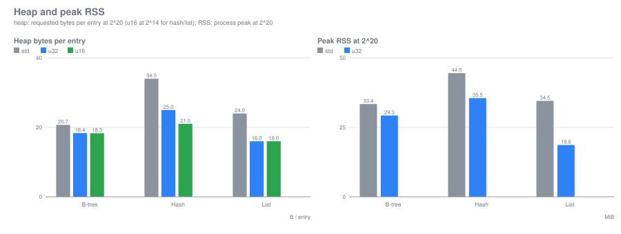
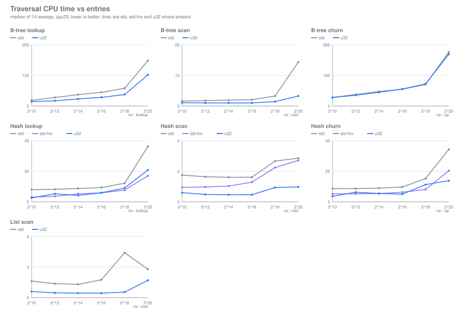
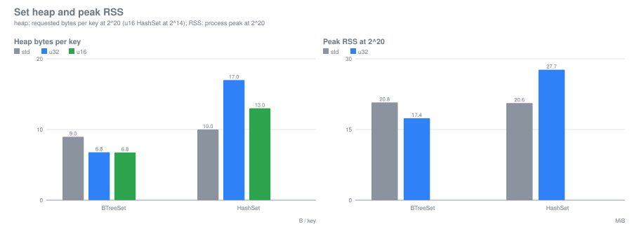
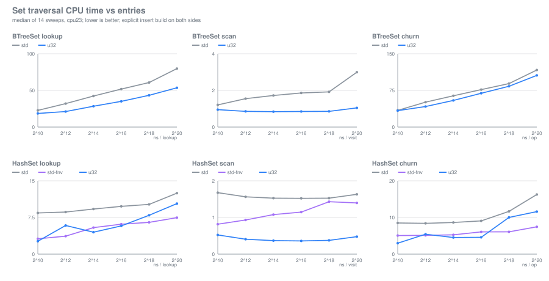

# rustlink

Narrow typed links for Rust: 1-, 2-, 4- or 8-byte offsets that replace 8-byte pointers inside
pointer-dense data structures. It adapts the [Goose](https://github.com/aardappel/goose) idea to
Rust and ships with benchmarks that measure where narrow links pay.

## What it provides

- `Abs`/`OptAbs` (absolute index) and `Rel`/`OptRel` (signed delta) at `u8`, `u16`, `u32` and
  `u64`. The width bounds a region's size or a link's distance; `Opt*` forms reserve null.
- Bounds-checked `Region`/`Cursor` resolution: wrong region, corrupt link or dangling link yields
  `None`/`Err`, never undefined behavior.
- `Arena<T>`: append-only storage whose indices never change, plus frozen, position-independent
  blobs with exact-length and link verification.
- `rustlink-collections`: `LinkedList`, `BTreeMap`/`BTreeSet` and `HashMap`/`HashSet` whose nodes
  live in one `Vec` and link by narrow indices.
- `#![no_std]` with `alloc`, no `unsafe`; the core crate has no feature flags.

## Reach

| Width | `Abs`: elements | `Rel`: delta |
|---|---:|---:|
| `u8` | 256 | -128 to 127 |
| `u16` | 65,536 | -32,768 to 32,767 |
| `u32` | 4,294,967,296 | -2^31 to 2^31 - 1 |
| `u64` | 2^64 | -2^63 to 2^63 - 1 |

`OptAbs` addresses one element fewer; `OptRel` cannot point at its own owner.

## Example

```rust
use rustlink::{Arena, BlobRef, OptAbs, Region, impl_links};
use zerocopy::byteorder::little_endian::U32;
use zerocopy::{FromBytes, Immutable, IntoBytes, KnownLayout, Unaligned};

// A tree node: a key and two optional links of 2 bytes each. The node is 8 bytes; the same node
// with two 8-byte pointers is 24.
#[derive(FromBytes, IntoBytes, Immutable, KnownLayout, Unaligned, Clone, Copy)]
#[repr(C)]
struct Node {
    key: U32,
    left: OptAbs<Node, u16>,
    right: OptAbs<Node, u16>,
}
impl_links!(Node, schema = 0x4558_414D_0001, links = [left, right]);

let mut arena = Arena::new();
let leaf = arena.push(Node { key: U32::new(1), left: OptAbs::NULL, right: OptAbs::NULL });
arena.push(Node { key: U32::new(2), left: OptAbs::new(Some(leaf))?, right: OptAbs::NULL });
assert_eq!(size_of::<Node>(), 8);

// Links are resolved against the arena with a bounds check.
let root = arena.cursor(1).unwrap();
let left = root.follow(root.get().left).unwrap();
assert_eq!(left.get().key.get(), 1);

// A frozen image holds no addresses. Verify it when loading it back.
let image = arena.freeze();
let view = BlobRef::<Node>::verify(&image)?;
assert_eq!(view.len(), 2);
# Ok::<(), Box<dyn std::error::Error>>(())
```

Nodes must be `Unaligned` to freeze; use `zerocopy`'s little-endian scalars. Blob verification
does not range-check links into another region; following them stays bounds-checked.

## What the benchmarks show

Most times below are ratios between variants inside one sweep; below 1 is faster. The first table
shows absolute ns for context. Heap is requested bytes, excluding allocator metadata. Machine and
merge rules are in each record's `environment.txt`.

### Pointer-dense structures

| Scenario | Best narrow | Heap B/node: narrow / `u32` / `box` | Time: narrow / `u32` |
|---|---|---|---|
| `bst-bulk` 2^22 | `abs32` | 12 / 12 / 24 | 150.8 / 152.5 ns |
| `bst-random` 2^20 | `abs32` | 12 / 12 / 24 | 187.6 / 189.5 ns |
| `ast` 2^22 | `abs32` | 12 / 12 / 24 | 10.2 / 10.1 ns |
| `graph-linked-seq` 2^20 | `rel8` | 24 / 36 / 72 | 16.1 / 13.0 ns |
| `graph-linked-shuf` 2^20 | `abs32` | 36 / 36 / 72 | 27.4 / 25.8 ns |

- 32-bit links halve tree-node heap (24 → 12 B) and speed lookups 1.7×–2.3×.
- On linked edge lists they save memory but not time; sub-32-bit links pay only when local.
- A verified blob loads about 4× faster than rebuilding the arena (1.33 vs 5.41 ns/node).
- Details: `bench/results.md`, `bench/environment.txt`.

### Node graphs and B-trees

| Heap B/node | `Rc`+`Weak` | `usize` | `u32`/`abs32` | `abs16`/`rel16` | `rel8` |
|---|---:|---:|---:|---:|---:|
| graph node (payload + 4 links) | 64 | 40 | 20 | 12 | 8 |

- Against `Rc`+`Weak`, `abs32` is 3.2× smaller and takes 0.28×–0.92× its time from 2^16 nodes up.
- Against hand-written `u32`, memory is equal; sweeps cost 1.2×–2.4×, but dependent chases and
  B-tree lookups are ~1.0×. `rel16` wins on large banded graphs (0.80×–0.83×).
- In a B-tree link width barely matters; packed trees beat `BTreeSet` by 1.6×–2.3× in time and
  1.2×–1.4× in memory, but are static.
- Layer-4 gate: `ast-bytes` uses 3.68× less heap at 0.81×–0.84× the time; layer 4 is not built.
- Details: `bench/decisive/results.md`, `bench/decisive/environment.txt`,
  `docs/superpowers/specs/2026-10-23-decisive-workloads-design.md`.

### Dynamic containers

`bench/containers/` compares the maps and list with std: 144 cells, 14 sweeps, 132 done and 12
skipped for width. Charts come from `results.jsonl` via `python3 bench/containers/plot.py`.

| Heap B/entry at 2^20 | `std` | `u32` | `u16` |
|---|---:|---:|---:|
| `BTreeMap<u32,u64>` | 20.7 | **18.4** | 18.3 |
| `HashMap<u32,u64>` | 34.0 | **25.0** | 21.0 (2^14) |
| `LinkedList<u64>` | 24.0 | **16.0** | 16.0 (2^14) |



| Time / `std` | 2^14 | 2^16 | 2^18 | 2^20 |
|---|---:|---:|---:|---:|
| `btree-lookup` | 0.62 | 0.63 | 0.65 | 0.65 |
| `btree-scan` | 0.51 | 0.49 | 0.43 | 0.24 |
| `btree-churn` | 0.95 | 1.00 | 1.04 | 0.98 |
| `hash-lookup` / `std-fnv` | 0.80 | 1.00 | 1.21 | 1.22 |
| `hash-scan` / `std-fnv` | 0.45 | 0.36 | 0.45 | 0.34 |
| `hash-churn` / `std-fnv` | 0.93 | 0.82 | 1.47 | 0.73 |
| `list-scan` | 0.34 | 0.26 | 0.13 | 0.63 |



- **Node capacity was the B+tree lever:** 128-entry leaves/inner nodes; at 2^20 lookup is 0.65×
  std, scan 0.24×, churn 0.98×, build 1.14× (14% slower), heap 18.4 vs 20.7 B.
- **The list is fast when contiguous:** `push_back`-built lists scan 0.13×–0.63× std; build is
  0.08×–0.10×. Removing from the front/middle falls back to link-following.
- **The hash map wins memory and scans:** 25 vs 34 B/entry; scan 0.34×–0.45× with the same hasher.
  Lookup with the same hasher is 0.80×–1.22× (slower at 2^18/2^20); the win over std's default
  SipHash map is mostly FNV, not the layout.
- **Bulk APIs mattered more than loop tuning.** `shrink_to_fit` 18.2 → 12.7 B/entry;
  `for_each_mut` 2.4 vs 103 ns/entry; `range` 29.3 µs vs std 79.3 and `iter().skip()` 316.6 for
  10,485 entries. `retain` wins when removing almost everything (3.19 vs 7.86 ns/entry) and loses
  when removing half (7.16 vs 5.77).
- Linear and branchless node search won microbenchmarks but lost in the real tree; binary search
  at 128 entries won.
- Details: `bench/containers/results.md`, `bench/containers/environment.txt`.

### Sets

`bench/sets/` compares `BTreeSet`/`HashSet` on `u32` keys: 126 cells, 14 sweeps, 117 done and 9
skipped. Both sides build with explicit inserts, so std's `collect()` bulk-load path is not
compared against random insertion. Charts: `python3 bench/sets/plot.py`.

| Heap B/key at 2^20 | `std` | `u32` | `u16` |
|---|---:|---:|---:|
| `BTreeSet<u32>` | 9.0 | **6.8** | 6.8 |
| `HashSet<u32>` | **10.0** | 17.0 | 13.0 (2^14) |



| Time / `std` | 2^14 | 2^16 | 2^18 | 2^20 |
|---|---:|---:|---:|---:|
| `btreeset-lookup` | 0.67 | 0.68 | 0.71 | 0.67 |
| `btreeset-scan` | 0.49 | 0.46 | 0.45 | 0.35 |
| `btreeset-churn` | 0.85 | 0.90 | 0.94 | 0.90 |
| `hashset-lookup` / `std-fnv` | 0.83 | 0.94 | 1.22 | 1.40 |
| `hashset-scan` / `std-fnv` | 0.34 | 0.31 | 0.26 | 0.34 |
| `hashset-churn` / `std-fnv` | 0.87 | 0.74 | 1.65 | 1.55 |



- `BTreeSet` is a clean win: 24% less memory, lookups 0.67×–0.71×, scans 0.35×–0.49×, churn
  0.85×–0.94×, build 0.86×–0.98×.
- `HashSet` loses memory (17 vs 10 B/key) because a key-only chained entry still pays the next
  link, liveness byte and bucket; scan is 0.26×–0.34×, lookup 0.83×–1.40×, churn 0.74×–1.65×.
- A `u16` B+tree holds ~5.7M entries; the `u16` hash map/set caps at 65,535.
- The 9 skipped cells are `u16` HashSet at 2^16 and up; details in `bench/sets/results.md`
  and `bench/sets/environment.txt`.

## Benchmarks

```text
cargo build --release --bins
target/release/sweep --out my.jsonl --md my.md     # full matrix
target/release/sweep --dry-run                     # list cells and the pinned CPU
target/release/rlb list                            # workloads, sizes, variants
target/release/sweep --report-only                 # re-render from results.jsonl
```

| Record | Cells | Scope |
|---|---:|---|
| `bench/` | 405 | trees, expression tree, graphs, blobs |
| `bench/decisive/` | 364 | node graphs, static B-trees |
| `bench/containers/` | 144 | maps, list |
| `bench/sets/` | 126 | set workloads |

All 28 workloads are registered; a plain `sweep` runs 1039 cells. Each cell runs in a fresh
process pinned with `taskset`. Heap is requested bytes (allocator overhead excluded); peak RSS
includes it. The container/set records use `CLOCK_THREAD_CPUTIME_ID`; the earlier records use wall
time on a pinned core. The machine is shared, so read ratios and IQRs, not absolute cross-record
times. Details and caveats: `bench/*/environment.txt`.

## Reading the numbers

- A cell marked `n/a` means the links cannot represent that size; `skip` was not measured. Notes
  give the reason.
- The `±` is the MAD within one process. Between-process variation is larger; treat differences
  under 10% as ties, and under 20% at 2^20 as unresolved.
- Background load can move large-cell ratios; check the pinned core is idle before a sweep, and
  prefer paired ratios over absolute times.
- One machine, one pinned core.
